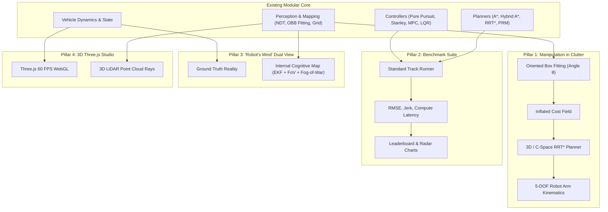
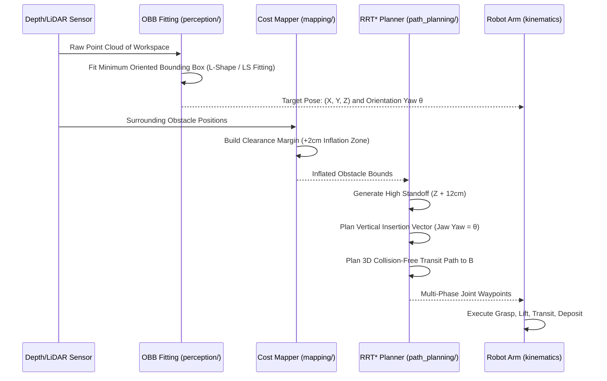

# Autonomous Vehicle & Robotics Innovation Roadmap

> **Author / Maintainer:** Dhruv Gupta  
> **Repository:** `AutonomousVehicleControlBeginnersGuide`  
> **Date:** November 5, 2026  
> **Status:** Active Proposal & Architectural Roadmap  

---

## 🌟 Executive Summary

This roadmap outlines high-impact engineering plans to evolve the `AutonomousVehicleControlBeginnersGuide` from a collection of standalone 2D algorithm scripts into an advanced, extensible robotics and autonomous navigation research platform. 

It covers four foundational pillars:
1. **Robot Arm Manipulation in Clutter (Angled Blocks & SLAM/Cost Mapping)**
2. **Automated Algorithmic Benchmarking Suite & Leaderboard**
3. **Dual-View "Robot's Mind" (Cognitive Belief State vs. Ground Truth)**
4. **2D to 3D WebGL Simulation (Three.js Engine)**
5. **Modern AI Integrations (Neural SLAM, DRL, and VLM Copilots)**



---

## 🏗️ Pillar 1: Robot Arm Manipulation in Crowded Clutter & Angled Blocks

### The Challenge
A robotic arm must pick an object at position $A$ and place it at position $B$.
* **Challenge 1 (Angle)**: The block is placed at an arbitrary yaw angle $\theta$, requiring precise gripper alignment.
* **Challenge 2 (Clutter)**: The block is tightly surrounded by other boxes, preventing direct diagonal approaches.

### Algorithmic Solution from this Repository



#### Step-by-Step Implementation:
1. **Oriented Bounding Box (OBB) Extraction**:
   - Utilize [`point_cloud_rectangle_fitting.py`](src/simulations/perception/point_cloud_rectangle_fitting/point_cloud_rectangle_fitting.py) and [`point_cloud_robustLS_rectangle_fitting.py`](src/simulations/perception/point_cloud_rectangle_fitting/point_cloud_robustLS_rectangle_fitting.py).
   - From sensor points, estimate center $(x, y, z)$ and principal axis rotation $\theta_{block}$.
2. **Wrist Angle Alignment**:
   - Set the gripper end-effector yaw:
     $$\theta_{gripper} = \theta_{block} \pmod{\frac{\pi}{2}}$$
3. **Obstacle Inflation & Clearance Buffer**:
   - Leverage [`cost_grid_map_construction.py`](src/simulations/mapping/cost_grid_map_construction/cost_grid_map_construction.py) to generate repulsive boundary buffers around non-target boxes.
4. **Staged Collision-Free Waypoint Pipeline**:
   - **Phase 1: Pre-Grasp Standoff**: Position arm at $(x, y, z_{standoff})$ with $\theta_{gripper}$ aligned.
   - **Phase 2: Linear Axial Descent**: Straight descent along $Z$-axis into the gap between boxes.
   - **Phase 3: Grip & Vertical Retract**: Close fingers and retract vertically to clearance ceiling.
   - **Phase 4: RRT\* Transit**: Use [`rrt_star_path_planning.py`](src/simulations/path_planning/rrt_star_path_planning/rrt_star_path_planning.py) to route over and around tall clutter toward target $B$.
   - **Phase 5: Insertion & Soft Release**: Deposit object at $B$ with zero residual momentum.

---

## 📊 Pillar 2: Automated Algorithmic Benchmarking Suite

Evaluate and rank all tracking and planning algorithms under identical, reproducible test conditions.

### Test Tracks
1. **Standard S-Curve**: Tests smooth continuous curvature tracking.
2. **High-Speed Double Lane Change (Elk Test)**: Tests lateral dynamics, tire slip, and rapid control response.
3. **Narrow Cluttered Urban Maze**: Tests tight turning radii and close obstacle navigation.

### Quantitative Metrics

| Metric | Formula / Definition | Unit | Target |
| :--- | :--- | :---: | :---: |
| **RMSE Cross-Track Error** | $\sqrt{\frac{1}{N}\sum_{i=1}^N e_{y,i}^2}$ | $\text{m}$ | Lower is better |
| **Max Tracking Deviation** | $\max_i |e_{y,i}|$ | $\text{m}$ | $< 0.15\text{ m}$ |
| **Heading Error RMSE** | $\sqrt{\frac{1}{N}\sum_{i=1}^N (e_{\theta,i})^2}$ | $\text{rad}$ | Lower is better |
| **Steering Jerk (Comfort)** | $\frac{1}{T}\int \left(\frac{d^2\delta}{dt^2}\right)^2 dt$ | $\text{rad/s}^2$ | Minimized |
| **Mean Compute Latency** | $\frac{1}{N}\sum_{i=1}^N \Delta t_{\text{compute}, i}$ | $\text{ms}$ | $< 10\text{ ms}$ (Real-time ECU) |
| **Collision Rate** | $\frac{N_{\text{collisions}}}{N_{\text{trials}}}$ | $\%$ | $0.0\%$ |

### Implementation Deliverable
- A new runner script: `benchmark_suite.py`
- Generates side-by-side radar plots, error histograms, and an automated Markdown leaderboard.

---

## 🧠 Pillar 3: Dual-Screen "Robot's Mind" (Belief State vs. Reality)

Create a split-screen visualizer displaying the contrast between objective truth and subjective robotic perception.

```
+------------------------------------+------------------------------------+
|         GROUND TRUTH REALITY       |        THE ROBOT'S MIND (BELIEF)   |
+------------------------------------+------------------------------------+
| • True vehicle coordinate (x, y)   | • Estimated pose (x_hat, y_hat)    |
| • Full map with all hidden hazards | • 95% Confidence Covariance Ellipse|
| • Ideal target trajectory          | • Real-time Occupancy Grid (LiDAR) |
| • Static global physics coordinates| • Fog of War (Unseen areas shaded) |
|                                    | • Receding Horizon MPC Rollout     |
|                                    | • Repulsive Potential Vector Field |
+------------------------------------+------------------------------------+
```

### Components Used:
- **Localization Filter**: [`extended_kalman_filter_localization.py`](src/simulations/localization/extended_kalman_filter_localization/extended_kalman_filter_localization.py) & UKF for covariance ellipses.
- **Occupancy Mapping**: [`binary_grid_map_construction.py`](src/simulations/mapping/binary_grid_map_construction/binary_grid_map_construction.py) & [`ndt_map_construction.py`](src/simulations/mapping/ndt_map_construction/ndt_map_construction.py).
- **Control Horizon**: [`mpc_path_tracking.py`](src/simulations/path_tracking/mpc_path_tracking/mpc_path_tracking.py) to render future projected candidate states.

---

## 🌐 Pillar 4: 2D to 3D WebGL Simulation with Three.js

Upgrade the 2D Matplotlib animation engine to a hardware-accelerated 3D WebGL experience in the browser.

### Features
1. **Kinematic 3D Vehicle Model**:
   - Detailed car mesh with spinning tires and Ackermann steering linkage on front wheels.
   - Body roll and pitch dynamics during aggressive braking and cornering.
2. **Volumetric LiDAR Point Clouds**:
   - 32-ring / 64-ring simulated LiDAR beams casting rays that terminate on 3D building and obstacle meshes.
   - Points color-coded by elevation or reflection intensity.
3. **Camera Rig Modes**:
   - **Cockpit Cam**: Look out the front windshield.
   - **Third-Person Follow Cam**: Dynamic spring-damped chase camera.
   - **Bird's Eye Drone Cam**: Orthographic top-down tactical overview.
4. **Trajectory Visuals**:
   - Reference path rendered as a glowing 3D spline ribbon.
   - Actual tire tracks rendered as surface skid/friction trails.

---

## 🤖 Pillar 5: Modern AI Integrations

### 1. Neural Scan Matching & Learned Odometry (AI SLAM)
- Replace classic iterative NDT optimization with a lightweight PointNet-based neural odometry network.
- Predicts $[\Delta x, \Delta y, \Delta \theta]$ directly from consecutive raw LiDAR sweeps in $< 1\text{ ms}$.

### 2. Deep Reinforcement Learning Local Planner (PPO / SAC)
- Train an autonomous navigation agent in PyBullet / MuJoCo:
  - **Observation**: 36-beam range array, current linear velocity $v$, angular velocity $\omega$, and relative target vector.
  - **Action**: Continuous target steering $\delta$ and acceleration $a$.
  - **Reward**: Progress along centerline + clearance distance penalty + smoothness incentive.

### 3. Multimodal VLM Copilot
- High-level decision layer powered by Google Gemini or local Vision-Language Models:
  - Ingests top-down birds-eye screenshots.
  - Interprets natural language user instructions:
    *"Overtake the slow bus on the left lane and park in the shaded bay."*
  - Emits discrete target waypoints for the low-level MPC/Pure Pursuit tracking controllers.

---

## 📅 Phased Execution Roadmap

| Phase | Milestone | Expected Deliverable |
| :---: | :--- | :--- |
| **Phase 1** | **Benchmarking Harness** | `benchmark_suite.py` comparing tracking controllers on standardized S-curve and Elk tests. |
| **Phase 2** | **Cognitive Dual-View Map** | Dual-viewport visualizer showing Ground Truth vs. EKF Covariance + Occupancy Grid. |
| **Phase 3** | **Angled Pick & Place in Clutter** | Integrating OBB rectangle fitting with RRT* trajectory generation for tabletop arm tasks. |
| **Phase 4** | **Three.js 3D WebGL Engine** | Interactive browser-based 3D visualizer with vehicle, 3D LiDAR point clouds, and multi-cam controls. |
| **Phase 5** | **Neural SLAM & DRL Policy** | Learned scan matching and reinforcement learning obstacle avoidance models. |

---

*This document serves as the architectural reference for upcoming development sprints.*

